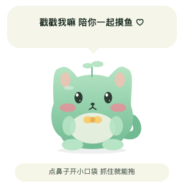
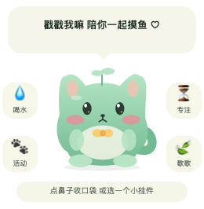
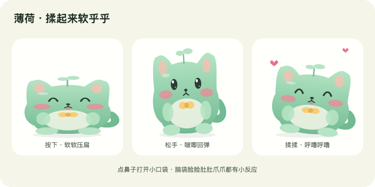

# 薄荷健康桌宠 ♡

一只软乎乎、会回弹、可以戳戳揉揉的 macOS 桌面小猫

薄荷会陪你写代码，也会提醒你喝口水、起来走走、歇一会儿
平时四个功能按钮都藏起来，点一下鼻子才打开小口袋，日常操作直接发生在小猫身上和身边

这个项目想留下一个很简单的提醒：**赚多少钱，也没有健康重要**

当前版本：**1.3.0**  
应用名称：**薄荷健康桌宠**  
运行平台：**Apple Silicon Mac**  
开发方式：**Swift + AppKit 原生桌面应用**

## 1 · 它现在能做什么

| 功能 | 当前行为 |
| --- | --- |
| 桌面陪伴 | 透明背景、悬浮小猫、轻轻呼吸和眨眼 |
| 鼻子开关 | 点鼻子展开四个功能挂件，再点一次收起 |
| 身体互动 | 脑袋、脸颊、肚子、小爪、尾巴分别有不同反应 |
| Q 弹揉捏 | 按住压扁，小幅度揉动会晃身子，松手过冲回弹后恢复原形 |
| 点击弹跳 | 点其他身体部位会弹跳，快速连点身体会更兴奋 |
| 拖动搬家 | 直接抓住小猫拖动，松手保存位置 |
| 喝水提醒 | 默认每 45 分钟提醒一次，可以手动记录 |
| 起身提醒 | 默认每 50 分钟提醒一次，可以手动记录 |
| 专注计时 | 小挂件开始 25 分钟专注，菜单里也能选择 50 分钟 |
| 休息计时 | 开始 5 分钟休息，小猫闭眼打个盹 |
| 提醒管理 | 调整间隔、分别开关提醒、暂停一小时、恢复、切换提示音 |
| 本地保存 | 保存设置、当天记录和桌宠位置 |
| 减少动态效果 | 跟随系统偏好，关闭弹跳和连续回弹等动作 |

当前没有健康面板或设置页面
日常功能通过小猫身边的挂件完成，更多设置放在右键菜单和菜单栏叶子里

应用没有接入 AI 对话模型，也没有语音识别、摄像头、健康传感器或跨设备同步
小猫说的话来自程序内置文案，健康记录由你手动确认

## 2 · 外观预览

### 平时的薄荷

按钮藏起来，只留下小猫、气泡和底部的小提示



### 点鼻子之后

小口袋打开，露出喝水、活动、专注、歇歇四个挂件



### 软软压扁和回弹



以上图片由应用的原生绘图代码导出，展示静态造型和布局，不是实机鼠标操作的录像

## 3 · 运行要求与安装

### 运行要求

| 项目 | 要求或说明 |
| --- | --- |
| 处理器 | Apple Silicon，当前提供 arm64 构建 |
| 系统版本 | 应用声明最低 macOS 13，旧版系统兼容性尚未实测 |
| 网络 | 当前功能不需要联网 |
| 账号 | 不需要注册或登录 |
| Node / Python | 运行应用不需要 |
| Xcode Command Line Tools | 仅修改源码后重新编译时需要 |

当前构建脚本面向 Apple Silicon Mac，没有提供 Intel Mac、Windows 或 Linux 构建
应用使用本地临时签名，没有 Apple Developer ID 公证

### 从 GitHub 获取并构建

本仓库提供源码、图标、预览和构建脚本，编译好的 `.app`、独立程序及发布 ZIP 不纳入 Git 版本管理
需要先安装 Xcode Command Line Tools，在正常的 macOS 终端执行

```sh
git clone https://github.com/govin-ai/mint-health-pet.git
cd mint-health-pet
zsh build.sh
```

构建完成后，目录中会生成 `薄荷健康桌宠.app` 和独立程序 `MintHealthPet`
接着可以采用下面任一启动方式

### 方法一：运行应用包

1. 按上面的步骤克隆并构建项目
2. 在 Finder 中打开 `mint-health-pet` 文件夹
3. 双击构建得到的 `薄荷健康桌宠.app`
4. 启动成功后，小猫应出现在桌面右下方，菜单栏出现一片叶子
5. 点小猫鼻子，就能展开功能挂件

应用采用菜单栏辅助应用模式，通常不会显示普通应用的 Dock 图标
退出入口在菜单栏叶子和小猫的右键菜单里

### 方法二：使用备用启动脚本

如果应用包没有正常打开，可以在 Finder 中双击 `备用启动.command`

这个脚本会由 macOS 终端直接运行同目录的 `MintHealthPet`，启动日志显示在终端里
运行期间保持终端窗口打开，可以将它最小化，退出仍使用小猫菜单里的“退出薄荷”

### 方法三：从 macOS 终端启动

在终端进入克隆后的项目目录，再执行

```sh
./MintHealthPet
```

也可以把 `MintHealthPet` 文件拖进终端，让终端自动填入它的完整路径，再按回车

这里指的是你正常桌面会话里的 macOS 终端
本次 Codex 工具执行环境没有成功显示窗口，相关诊断见后面的“启动排查与已知限制”

### 更新已有版本

1. 从菜单栏叶子退出旧版薄荷
2. 获取新版源码，重新运行 `zsh build.sh` 构建
3. 再启动新版应用或备用程序

已经运行的旧进程不会因为磁盘文件被替换而自动变成新版

## 4 · 鼻子是小开关

四个功能按钮默认隐藏，直接点小猫鼻子才会展开

| 操作 | 结果 |
| --- | --- |
| 点鼻子 | 打开小口袋，显示四个功能挂件 |
| 再点鼻子 | 关闭小口袋，隐藏挂件 |
| 选择一个功能 | 执行对应动作，然后收起挂件 |
| 闲置 8 秒 | 小口袋自动收起 |
| 正在按住功能按钮 | 不会在按下期间突然收起 |
| 拖动小猫本体搬家 | 收起挂件，让小猫跟着鼠标移动 |

隐藏后的挂件不会响应喝水、活动或计时操作
点按钮所在的空白位置，不会偷偷增加健康记录

鼻子命中位置会根据小猫当前的缩放、倾斜和弹跳状态换算，避免回弹时还按旧位置判断
鼻子点击留有一定容差，不要求你准确点中那几个绘图像素

## 5 · 戳哪里，会发生什么

| 位置或动作 | 小猫的反应 | 气泡文案示例 |
| --- | --- | --- |
| 鼻子 | 小鼻子轻轻变形，打开或收起小口袋 | 啵 小口袋打开啦 ♡ |
| 脑袋 | 眯眼、轻轻歪头、飘爱心 | 摸摸脑袋 我就乖乖啦 ♡ |
| 脸颊 | 脸红更明显，露出开心的表情 | 哎呀 脸脸被你戳红啦 ♡ |
| 肚子 | 左右扭动，身体软软变形 | 痒痒痒 肚肚要扭起来啦 ♡ |
| 小爪 | 挥动右侧小爪，打个招呼 | 小爪爪跟你说嗨呀 🐾 |
| 尾巴 | 摇摇尾巴 | 尾巴摇摇 今天也喜欢你 ♡ |
| 其他身体部位 | 弹跳、眯眼，从几句内置文案中选择一句 | 我是一颗弹弹的薄荷团子 ♡ |
| 快速连点身体 | 更兴奋地弹跳 | 嘿嘿 开心到蹦起来 ♡ |

### 揉揉它

按住小猫的身体，身子会软软压扁
轻轻左右揉，小猫会晃动、眯眼、吐舌头，飘出小爱心

松手后不会突然切回原形，而是先弹过一点，再回落，最后慢慢停下来
这是阻尼弹簧模拟带来的回弹效果

鼻子负责展开功能，因此单纯按住鼻子不会先把它压走
从鼻子开始小幅揉动后，会转成身体揉捏

### 哪些动作不会改变健康记录

戳鼻子、摸脑袋、戳脸、挠肚子、点爪子、摇尾巴、揉捏、弹跳和拖动，都不会增加喝水或活动次数
只有你选择对应的健康挂件或菜单动作，才会写入记录

## 6 · 抓住它，拖到喜欢的位置

薄荷可以直接拖动，不必只抓底部标签

1. 在小猫本体上按下鼠标
2. 向你想放的位置拖动
3. 小猫和身边的气泡、提示一起移动
4. 松手后保存位置，下次启动会尝试恢复

### 揉捏和拖动怎么区分

- 从按下位置算起，移动幅度小于 14 个屏幕点时，仍属于轻轻揉捏
- 移动达到 14 个屏幕点时，切换为拖动整个桌宠
- 一旦进入拖动，本次按住期间就保持拖动，不会来回切换成揉捏
- 松手后保存位置，不会误触身体点击反应或健康按钮

这里的“屏幕点”是 macOS 界面坐标单位，不能直接当成 Retina 屏幕的物理像素数

你也可以拖动底部标签，或者按住 Shift 再拖小猫

程序会尝试把桌宠位置限制在屏幕可见区域内
多显示器和全屏空间切换的实际效果仍待实机验证

## 7 · 四个健康小挂件

点鼻子展开之后，就可以使用下面四个挂件

| 挂件 | 当前动作 | 记录或计时变化 |
| --- | --- | --- |
| 💧 喝水 | 告诉薄荷你已经喝过水 | 当天喝水次数 +1，从当前时间重新计算下次喝水提醒 |
| 🐾 活动 | 告诉薄荷你已经起身活动 | 当天活动次数 +1，从当前时间重新计算下次起身提醒 |
| ⏳ 专注 | 空闲时开始 25 分钟专注 | 显示剩余时间，暂停喝水和起身提醒 |
| 🍃 歇歇 | 开始 5 分钟休息 | 小猫闭眼，显示休息剩余时间 |

### 喝水记录

记录的是确认次数，不是毫升数，也没有固定的每日饮水目标
小猫不会自动判断你有没有喝水

每点一次喝水挂件或菜单中的喝水动作，就增加一次记录
当前没有撤销记录的入口，误点会影响当天计数

### 活动记录

记录的是你手动确认的起身活动次数
点击“歇歇”只是开始休息计时，不会被算作已经完成活动

休息后如果确实起身走动了，可以再点“活动”记下来

### 专注与休息

小猫当前只能运行一个专注或休息计时
开始新的计时会替换当前计时

- 空闲时点 ⏳，开始 25 分钟专注
- 右键菜单或菜单栏叶子里可以选择 50 分钟专注
- 已有专注或休息计时时，⏳ 的文字变成“结束”，点击取消当前计时
- 点 🍃，开始 5 分钟休息
- 已经处于休息计时时，再点 🍃 不会重新开始这一轮休息
- 计时结束后回到空闲状态，不自动开始下一轮
- 当前计时不会在应用退出后保存和恢复

点气泡或底部标签，可以让薄荷在气泡里告诉你当天喝水和活动的次数

## 8 · 提醒节奏和设置

### 默认设置

| 设置 | 默认值 | 菜单可选项 |
| --- | --- | --- |
| 喝水提醒 | 开启，每 45 分钟 | 30 / 45 / 60 / 90 分钟，或关闭 |
| 起身提醒 | 开启，每 50 分钟 | 20 / 30 / 45 / 50 / 60 分钟，或关闭 |
| 提示音 | 关闭 | 开启或关闭 |
| 一键暂停 | 未暂停 | 暂停一小时，也可提前恢复 |

右键小猫，或者点击菜单栏叶子，进入“提醒设置”子菜单
设置会立即保存，修改后从当前时间重新计算两类提醒

这里使用原生菜单，不会打开设置页面

### 提醒显示在哪里

提醒出现在小猫头上的气泡里
当前没有接入 macOS 通知中心

如果你隐藏了桌宠，仍在后台运行时看不到气泡提醒
如果开启了提示音，提示音设置仍可能生效

### 专注时为什么不弹喝水提醒

专注和休息期间，喝水与起身提醒会暂时安静下来
计时结束或手动结束后，从当前时间重新安排提醒，避免一次性弹出积压提示

### 暂停一小时

暂停只影响喝水和起身提醒，不会停止专注或休息倒计时
一小时到期后恢复提醒，并重新计算提醒时间，不补发这段时间积压的提醒

### 休眠和重新启动

- 睡眠唤醒后重新安排喝水和起身提醒
- 专注或休息的剩余时间按真实时间计算，睡眠期间仍然流逝
- 如果计时已经到期，唤醒后结算完成状态
- 应用退出后不再运行提醒
- 重新打开应用后，从当前时间重新安排喝水和起身提醒

## 9 · 数据保存与运行边界

设置和记录保存在本机 macOS UserDefaults 中
程序没有账户系统、服务器、网络请求或跨设备同步

| 数据 | 当前处理方式 |
| --- | --- |
| 喝水提醒间隔和开关 | 本地保存 |
| 起身提醒间隔和开关 | 本地保存 |
| 提示音开关 | 本地保存 |
| 当天喝水和活动次数 | 本地保存，日期改变时归零 |
| 暂停提醒的到期时间 | 本地保存 |
| 桌宠位置 | 本地保存，启动时尝试恢复 |
| 专注或休息计时 | 仅当前进程内保存，退出后丢弃 |
| 鼻子小口袋展开状态 | 临时状态，下次启动默认关闭 |
| 爱心、脸红和其他互动动画 | 临时状态，不作为健康记录 |

每日计数根据本机日历日期切换，不是固定每隔 24 小时清零
跨日后，下次计时检查或记录操作会更新当天状态

数据键包含 `MintHealthState` 和 `MintPetPosition`
应用包的标识为 `local.mint.healthpet`
当前使用 `UserDefaults.standard`，独立程序和应用包的偏好数据域可能不同，不保证两种启动方式之间自动共享记录

程序没有修改登录启动项，也没有实现自动更新
随应用提供源码，不代表已经附带特定的开源许可；当前文件夹没有 LICENSE 文件

## 10 · 减少动态效果

薄荷会读取系统的“减少动态效果”偏好

开启后保留必要的按压反馈，同时关闭弹跳、弹簧来回晃动、呼吸动画、新生成的爱心粒子，以及连续挥爪和摇尾巴等动作

功能按钮、健康计时、记录、拖动和气泡仍然可以使用

具体触摸反馈分为两层：一层是状态和表情，另一层是连续运动
减少动态效果不会把健康功能一起关闭

## 11 · 项目文件结构

```text
mint-health-pet/
├── .gitignore                # 忽略本地构建产物与临时文件
├── README.md                 # 详细项目说明，也就是本文
├── 使用说明.md               # 简明操作手册
├── 薄荷健康桌宠.app/          # 本地构建生成，不提交到 Git
├── MintHealthPet             # 本地构建生成，不提交到 Git
├── 备用启动.command          # 从正常 macOS 终端启动的脚本
├── build.sh                  # 本地构建与自检脚本
├── Source/
│   ├── main.swift            # 应用、绘图、互动、健康计时与自检
│   ├── Info.plist            # 版本、应用标识、最低系统版本等配置
│   └── AppIcon.icns          # 应用图标
├── preview.png               # 默认状态的静态预览
├── preview-pet.png           # 默认桌宠预览副本
├── preview-open.png          # 鼻子小口袋展开状态
├── preview-rua.png           # 压扁、回弹、揉捏造型
└── preview-icon.png          # 图标绘图导出
```

### 主要代码组成

| 类型或函数 | 作用 |
| --- | --- |
| `HealthState` | 保存提醒设置、每日计数、提醒时间和暂停状态 |
| `HealthModel` | 管理健康记录、专注休息状态、日期切换与提醒事件 |
| `JellySpring` | 计算压扁、倾斜、揉动、松手后的阻尼回弹 |
| `PetHop` | 计算点击弹跳、重力、落地和停止 |
| `NoseTray` | 管理鼻子小口袋的展开、关闭和闲置超时 |
| `PetAction` | 定义四个挂件的点击区域和动作类型 |
| `TouchZone` | 识别鼻子、脑袋、脸颊、肚子、小爪、尾巴和其他身体部位 |
| `catPoint` | 把鼠标位置换算回变形前的角色坐标 |
| `drawCat` | 用原生路径、渐变和几何图形画出小猫及其反应 |
| `PetView` | 处理鼠标输入、拖动、粒子、挂件绘制和互动状态 |
| `AppDelegate` | 创建悬浮窗口、菜单栏、计时器，处理睡眠唤醒与设置 |
| `selfTest` | 执行计时、保存、弹簧、弹跳和命中区域检查 |
| `exportPNG` | 导出静态预览 PNG |

角色本体由代码绘制，运行时不依赖下载的角色图片或 GIF
图标使用本地 `.icns` 文件

## 12 · 本地开发与构建

### 准备工具

修改源码后重新编译，需要 macOS 上的 Swift 编译器和 Xcode Command Line Tools

可以在正常终端检查

```sh
swift --version
xcrun --find swiftc
```

本次使用的编译器为 Swift 6.2.4，构建目标为 `arm64-apple-macosx13.0`
这表示应用声明部署目标是 macOS 13，不等于已经在每个 macOS 13 及以上版本实测

### 一键构建

在项目目录执行

```sh
zsh build.sh
```

脚本会按顺序完成

1. 创建应用包目录
2. 用 Swift 编译 `Source/main.swift`
3. 写入应用配置和现有图标
4. 使用本地临时签名签署应用包
5. 更新备用独立程序
6. 设置备用脚本的执行权限
7. 执行应用内置自检

`build.sh` 不会自动安装应用，不会自动生成发布 ZIP，也不会自动重新生成图标

### 常见修改位置

| 想调整什么 | 从哪里看起 |
| --- | --- |
| 默认提醒间隔 | `HealthState` 的 `waterMinutes`、`moveMinutes` |
| 设置菜单里的可选间隔 | `AppDelegate.makeMenu` |
| 鼻子小口袋自动收起时间 | `NoseTray` |
| 脑袋、脸颊等触摸区域 | `TouchZone.at` |
| 小猫说的话 | `PetView.respond` 和 `AppDelegate` 的气泡文案 |
| 揉捏弹性和阻尼 | `JellySpring.step` |
| 点击弹跳力度 | `PetHop.kick` 和 `PetHop.step` |
| 拖动和揉捏的分界 | `PetView.mouseDragged` 中的 14 点阈值 |
| 小猫形状、颜色和表情 | `drawCat` |
| 四个挂件的位置 | `PetAction.rect` |
| 版本号和应用标识 | `Source/Info.plist` |

调整绘图和触摸区域时，需要一起检查视觉位置和命中位置
只移动绘图、不更新命中区域，会造成“看起来点到了，但没有反应”

### 运行自检

```sh
./MintHealthPet --self-test
```

也可以检查应用包中的可执行程序

```sh
"薄荷健康桌宠.app/Contents/MacOS/MintHealthPet" --self-test
```

### 导出预览

```sh
./MintHealthPet --preview preview.png
```

这会导出默认桌宠、展开挂件、图标和揉捏造型的静态 PNG，不启动常驻桌宠
当前预览路径会创建默认的健康模型，因此可能读写当前启动方式对应的本地偏好数据
如果需要严格隔离已有记录，可以在单独测试账户中生成预览

### 检查应用签名与配置

```sh
codesign --verify --deep --strict "薄荷健康桌宠.app"
plutil -lint "薄荷健康桌宠.app/Contents/Info.plist"
```

### 手动重新打包

在项目目录的上一级执行

```sh
ditto -c -k --sequesterRsrc --keepParent \
  "mint-health-pet" "薄荷健康桌宠-macOS.zip"
```

## 13 · 已完成的验证

| 检查 | 当前结果 |
| --- | --- |
| Swift 编译 | 通过 |
| 内置 34 项自检 | 通过 |
| 鼻子坐标逆变换的额外 36 组变形组合检查 | 通过，与原生变换结果核对 |
| 默认状态和展开状态静态预览 | 已检查 |
| 应用本地签名检查 | 通过 |
| 应用配置文件格式检查 | 通过 |
| 发布 ZIP 完整性检查 | 通过 |
| Codex 工具环境内正常显示桌宠 | 未成功 |
| 正常 macOS 桌面会话中的真实鼠标操作 | 尚未验证 |
| 多显示器、全屏空间切换 | 尚未验证 |
| 旧版 macOS、长时间运行 | 尚未验证 |

34 项自检覆盖的内容包括

- 启动时不会立即发出积压提醒
- 喝水与活动提醒按设置时间触发
- 手动记录只增加一次
- 专注期间不发喝水、起身提醒
- 专注和休息按时完成，结束后不连续补发提醒
- 暂停一小时与恢复提醒的状态处理
- 暂停提醒不影响专注计时
- 手动结束计时与跨日归零
- 设置和每日计数的保存与恢复
- 按住压扁、松手过冲、最终收敛
- 快速揉动和长帧间隔的边界处理
- 减少动态效果
- 点击弹跳、落地和停止
- 四个挂件的命中区域
- 隐藏按钮不会响应健康操作
- 鼻子展开、再次点击关闭、闲置自动关闭
- 按住挂件期间保持展开
- 鼻子位置换算和不同身体区域识别

额外 36 组几何检查验证了鼻子在不同压扁、倾斜、弹跳和呼吸状态下的坐标换算
这些检查验证程序逻辑，不代替正常桌面会话中的鼠标手感和窗口显示验收

## 14 · 启动排查与已知限制

### 程序还在运行，但桌面没有小猫

本次工具执行环境中出现过这种情况
日志包含

```text
Connection Invalid error for service com.apple.hiservices-xpcservice
```

进一步诊断确认，程序虽然进入了应用事件循环，但没有触发 `applicationDidFinishLaunching`，因此没有创建桌宠窗口

本次启动没有完成窗口初始化，进程存活不能作为小猫已显示的证据
需要从正常的 macOS 终端或 Finder 启动，并观察实际窗口

### 应用包打不开

本次工具环境通过系统启动器打开应用包时返回过 LaunchServices 错误
可以先使用 `备用启动.command` 或独立程序保留启动日志

如果仍然失败，记录终端输出、macOS 版本、处理器类型和采用的启动方式，再根据实际错误定位
当前构建没有 Developer ID 公证，不能把本地签名检查通过当成所有电脑上的发布安装验证

### 鼻子点了没反应

确认运行的是 1.3.0 新版，而不是仍在运行的旧进程
轻轻点鼻子后松手，不要同时把小猫拖走
如果发生较大位移，输入会切换成搬家，并收起挂件

### 拖动时为什么会先软软变形

按下小猫身体时先进入揉捏状态
移动达到 14 个屏幕点后才转成拖动，避免轻轻摸一下就把它带跑

如果只想马上搬家，可以拖动底部标签，或者按住 Shift 拖动小猫

### 为什么今天的次数和预想的不一样

记录只统计手动确认次数
开始休息不会增加活动次数，单纯玩小猫也不会增加次数
日期切换后归零，独立程序和应用包的本地偏好数据域也可能不同

当前没有每日历史列表、记录撤销、导出或同步功能

### 为什么退出后专注没有继续

当前专注和休息计时只存在于运行中的进程里
退出后不恢复，重新打开要重新开始一轮

### 可能同时出现多只小猫

独立程序没有额外实现单实例锁，重复启动可能运行多个进程
可以从各自的菜单栏叶子退出多余的实例

## 找 G 哥聊聊 ♡

想做 AI Agent、桌宠、自动化工具，或者把一个想法变成能用的软件，都可以找 G 哥聊聊

**项目咨询、软件定制、AI 应用开发、商单合作、产品推广、合作共创**，欢迎联系

📮 邮箱：[**piggerai@gmail.com**](mailto:piggerai@gmail.com)  
🐦 推特 / X：[@goan999999](https://x.com/goan999999)  
💬 TG 电报：[@goan999999](https://t.me/goan999999)

## 找 G 哥聊聊 ♡

想做 AI Agent、桌宠、自动化工具，或者把一个想法变成能用的软件，都可以找 G 哥聊聊

**项目咨询、软件定制、AI 应用开发、商单合作、产品推广、合作共创**，欢迎联系

📮 邮箱：[**piggerai@gmail.com**](mailto:piggerai@gmail.com)  
🐦 推特 / X：[@goan999999](https://x.com/goan999999)  
💬 TG 电报：[@goan999999](https://t.me/goan999999)
